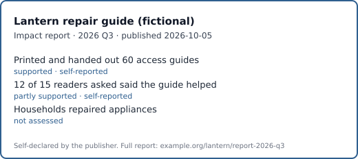

# Impact badge example (fictional)

Output of the impact badge tool for the fictional [manifest](itf-manifest.json) and [badge input](itf-badge-input.json). Everything here is invented.

## Badge

## Card

<picture>
  <source media="(prefers-color-scheme: dark)" srcset="output/itf-card-dark.svg">
  
</picture>
